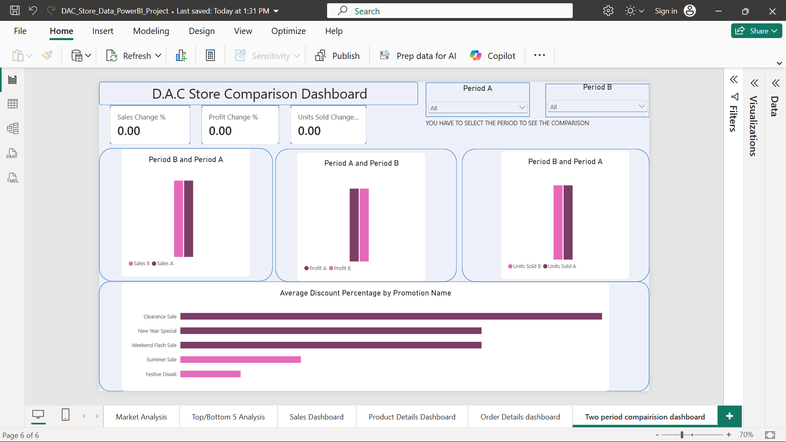
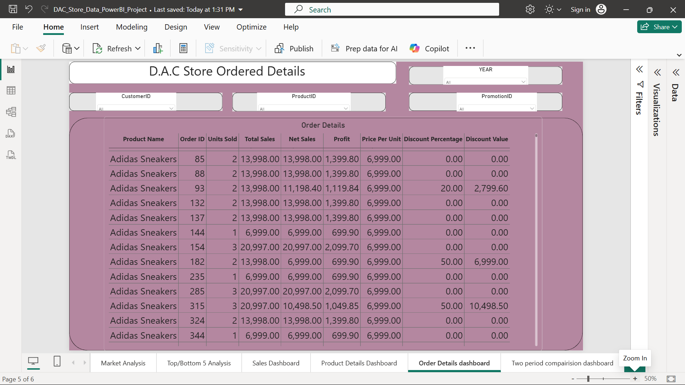
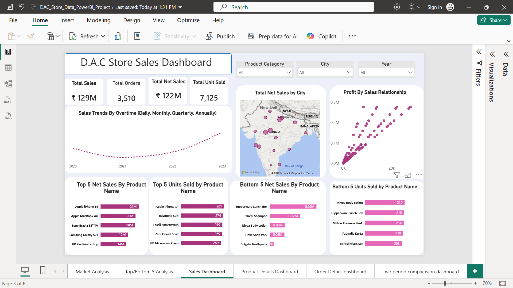
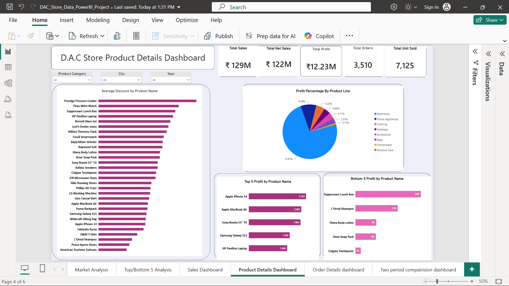

# 📊D.A.C_Store_sales_and_product_Dashboard_PowerBI
This Project analyzes a supermarket called D.A.C Store using PowerBI. The store is equiped with different product category, i.e Accessories, Bags, Clothing, Electronics, Footwear, Home appliances, Kitchenware and personal care
This project is also a demonstration of my PowerBI skill for my data analytics portfolio.

## 🔎Business Questions Answered
- Top/Bottom 5 product by sales/Profit/Qunatity Sold
- How do sales trends vary overtime (daily, monthly, quantity, annually)
- Show relationship between Sales and Profit
- Compare Sales/Profit/Quantity Sold between two period selected by users
- Average discount offered in each discount category
- Total Number of orders
- Total Net sales by city
- Product category with the highest profit in percentage

## 📈Key KPI
- Total Sales
- Total Net Sales
- Total Unit Sold
- Total Number of Order
- Total Profit

## ⚒️Toolz Used
- PowerBI
- Power Query
- Merge
- Column indexing
- Dahboard Design Techniques

## 📸Dashboard Preview

## 💡Key Insight
The D.A.C Store dashboard covers 3,510 orders from 50 customers across 16 cities, 30 products and 8 product lines, from January 2020 to December 2023, plus a single order on 1 January 2024. Total sales were ₹129.49M and net sales ₹122.31M, from 7,125 units. The average order is worth about ₹36.9K and contains about two units.

Assumptions: profit is a flat 10% of net sales; orders with PromotionID 0 are treated as having no promotion; discounts are 20% (Summer Sale), 10% (Festive Diwali), 50% (Weekend Flash Sale), 70% (Clearance Sale), and Buy 1 Get 1 Free (New Year Special) is treated as 50%.
### 1. Which products perform best and worst?
Five electronics products carry the store. Apple iPhone 14 (₹22.5M), Apple MacBook Air (₹20.8M), Sony Bravia 55" TV (₹20.5M), Samsung Galaxy S21 (₹16.1M) and HP Pavilion Laptop (₹15.5M) together deliver 73.7% of all sales. The bottom five (Colgate Toothpaste, Dove Soap Pack, Nivea Body Lotion, L'Oreal Shampoo and Tupperware Lunch Box) deliver just 0.5% combined, and Colgate Toothpaste alone sold ₹22K in four years. Profit ranks the products in exactly the same order as sales, because profit is a flat 10%.
Volume tells a different story. Every product sold between 203 and 281 units, so revenue differences come almost entirely from price, not demand. The top five by units are iPhone 14 (281), Raymond Suit (274), Fossil Smartwatch (269), Zara Casual Shirt (269) and IFB Microwave Oven (259). The bottom five are Borosil Glass Set (203), FabIndia Kurta (210), Milton Thermos Flask (214), Tupperware Lunch Box (215) and Nivea Body Lotion (219). Personal Care sells 13% of all units but only 0.3% of sales.

### 2. How do sales trend over time?
Sales fell from ₹33.2M in 2020 to ₹31.2M in 2021 and ₹29.7M in 2022, then recovered strongly to ₹35.3M in 2023, a rise of 18.8% and the best year on record (953 orders). The 2024 figure is not a real decline: the dataset holds only one order from 2024, so it should be excluded from trend analysis. Within the year, October and November are the strongest months (about ₹3.0M each on average), the fourth quarter holds 26.2% of sales against 23.7% for the first, and March and December are the weakest months.
### 3. What is the relationship between sales and profit?
The relationship is perfectly linear (correlation of 1.0), but only because profit is assumed to be a flat 10%. The chart therefore shows that profit follows sales and says nothing about which products earn better margins. Real cost data would be needed to find high-volume, low-margin products.
### 4. How do two periods compare?
Users can pick any two date ranges and see sales, profit and units side by side. Comparing 2022 with 2023: sales rose 18.8% (₹29.71M to ₹35.31M), orders rose 11.6% (854 to 953), and units rose 9.9% (1,741 to 1,913). Sales grew faster than units because the average order rose from ₹34.8K to ₹37.1K

### 5. How many orders were placed?
There were 3,510 orders covering 7,125 units, which is about two units and ₹36.9K per order. That average order value is consistent with high-ticket electronics driving the business.

### 6. Can I see every order in detail?
Yes. The Order Detail page lists sales, profit, discount, net sales and every other field for each order, filterable by product, date, customer ID and promotion category.

### 7. Where are sales coming from?
Bhopal (₹16.2M, 12.5%), Kanpur (₹15.0M, 11.5%) and Indore (₹14.0M, 10.8%) are the top cities, and together make up 34.9% of sales. By state, Madhya Pradesh (23.3%), Maharashtra (21.0%) and Uttar Pradesh (20.1%) bring in 64.4%. Bangalore (₹1.6M) and Hyderabad (₹3.5M) are the weakest. City sales largely follow the number of customers in each city (Bhopal and Kanpur have six each, Bangalore has one), so growth depends on how many customers a city has, not on how much each one spends.

### 8. What is the average discount in each discount category?
79.5% of orders (2,790) had no promotion. Across all orders the average discount is 5.7%, but on orders that did use a promotion it is 27.6%. Summer Sale accounts for 59% of all discount spend. The Clearance Sale ran only in 2023 and turned ₹1.49M of goods into just ₹0.45M of revenue. Discounting nearly tripled in 2023, from ₹1.07M (3.6% of sales) to ₹3.01M (8.5%), which is why net sales grew by 12.8% against 18.8% for gross sales. About 73% of all discount value was given on electronics.

## 📁File in this repository
[Store_data](Store+Data.xlsx)
[Sales](Sales_Detail.png)
[Product](Product_Detail.png)
[Order](Order_Details.png)
[Comparison](Comparison_details.png)

## 📍Conclusion
- Protect the five electronics lines. They bring in nearly three quarters of sales, so keep them fully stocked and prioritised for marketing.
- Cut back deep discounts on electronics. Electronics already sells well at full price, yet it receives about 73% of all discount value. Repeating the 50% and 70% promotions on high-ticket items gives away revenue the store would probably have earned anyway.
- Review the Clearance Sale before repeating it. It helped lift 2023, but at 70% off it kept less than a third of the sales value. Test whether a smaller discount works.
- Rethink the bottom five products. They contribute 0.5% of sales, so either bundle them with electronics purchases or free up shelf space.
- Grow the customer base in under-represented cities. Delhi, Chennai, Hyderabad and Bangalore have one or two customers each, and customers there spend about as much as elsewhere.
- Time promotions around the calendar. Plan stock for the October to November peak, and use the weaker months (March and December) for targeted offers.
- Fix the data gaps. Load full 2024 data and add product cost data so profit can be measured properly.
